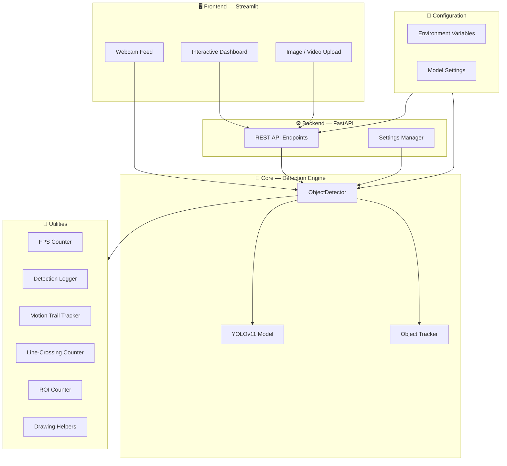

<div align="center">

# 🎯 Object Detection System

**Real-time object detection, tracking, and analytics powered by YOLOv11**


[Features](#-features) · [Quick Start](#-quick-start) · [API Docs](#-api-documentation) · [Docker](#-docker) · [Contributing](#-contributing)

</div>

---

## 📖 Project Overview

The **Object Detection System (ODS)** is a production-ready computer vision platform that brings together state-of-the-art YOLOv11 object detection with an intuitive web dashboard and a robust REST API. It supports **image**, **video**, and **real-time webcam** detection out of the box, complete with multi-object tracking, line-crossing counting, region-of-interest analytics, and motion-trail visualisation.

Whether you need to count vehicles at an intersection, monitor foot traffic, or detect objects in uploaded images via an API, ODS has you covered.

---

## ✨ Features

### Detection & Tracking
- 🖼️ **Image Detection** — Upload images and get instant detection results with bounding boxes
- 🎬 **Video Detection** — Process video files with frame-by-frame analysis
- 📹 **Webcam Detection** — Real-time detection from connected cameras
- 🔄 **Multi-Object Tracking** — Persistent identity tracking across frames (BoT-SORT / ByteTrack)
- 🏃 **Motion Trails** — Visualise object movement paths over time

### Analytics & Counting
- 📊 **Line-Crossing Counter** — Count objects crossing user-defined lines
- 🎯 **Region-of-Interest (ROI) Counting** — Count objects within polygonal zones
- 📈 **Detection Statistics** — Real-time FPS, inference time, and detection metrics
- 📋 **Detection Logging** — Structured logs for post-analysis

### Platform
- 🌐 **REST API** — FastAPI-based endpoints for programmatic access
- 🖥️ **Streamlit Dashboard** — Interactive web UI for configuration and visualisation
- ⚡ **Configurable Models** — Switch between YOLO model sizes (Nano → Extra-Large) on the fly
- 🎛️ **Adjustable Thresholds** — Confidence and IoU thresholds via UI or API
- 🐳 **Docker Support** — Single-command deployment with Docker

---

## 🏗️ Architecture



---

## 🛠️ Tech Stack

| Component        | Technology                        | Purpose                          |
|:-----------------|:----------------------------------|:---------------------------------|
| **Detection**    | Ultralytics YOLOv11               | State-of-the-art object detection|
| **Backend**      | FastAPI + Uvicorn                 | High-performance REST API        |
| **Frontend**     | Streamlit                         | Interactive web dashboard        |
| **Computer Vision** | OpenCV                        | Image/video processing           |
| **Configuration**| Pydantic Settings                 | Type-safe config management      |
| **Tracking**     | BoT-SORT / ByteTrack             | Multi-object tracking            |
| **Containerisation** | Docker                       | Reproducible deployment          |
| **Testing**      | pytest                            | Automated test suite             |

---

## 📦 Installation

### Prerequisites

- Python 3.11 or higher
- Git
- (Optional) NVIDIA GPU with CUDA for accelerated inference

### Step-by-Step

```bash
# 1. Clone the repository
git clone https://github.com/your-org/object-detection-system.git
cd object-detection-system

# 2. Create and activate a virtual environment
python -m venv venv

# Windows
venv\Scripts\activate
# macOS / Linux
source venv/bin/activate

# 3. Install dependencies
pip install -r requirements.txt

# 4. (Optional) Download a YOLO model manually
#    Models are auto-downloaded on first run, but you can pre-fetch:
python -c "from ultralytics import YOLO; YOLO('yolo11n.pt')"
```

---

## 🚀 Quick Start

### Start the API Server

```bash
uvicorn app.api:app --host 0.0.0.0 --port 8000 --reload
```

The API will be available at **http://localhost:8000**. Interactive docs at **http://localhost:8000/docs**.

### Start the Streamlit Dashboard

```bash
streamlit run app/streamlit_app.py --server.port 8501
```

Open **http://localhost:8501** in your browser.

### Run Both Together

```bash
# Terminal 1 — API
uvicorn app.api:app --host 0.0.0.0 --port 8000

# Terminal 2 — Dashboard
streamlit run app/streamlit_app.py --server.port 8501
```

---

## 📸 Usage

### Image Detection

```python
import requests

# Upload an image for detection
url = "http://localhost:8000/detect/image"
with open("photo.jpg", "rb") as f:
    response = requests.post(url, files={"file": f})

results = response.json()
for det in results["detections"]:
    print(f'{det["class_name"]}: {det["confidence"]:.2f}')
```

### Get Annotated Image

```python
# Get the image back with bounding boxes drawn
url = "http://localhost:8000/detect/image/annotated"
with open("photo.jpg", "rb") as f:
    response = requests.post(url, files={"file": f})

with open("annotated.png", "wb") as f:
    f.write(response.content)
```

### Webcam Detection (via Streamlit)

1. Open the Streamlit dashboard at **http://localhost:8501**
2. Select **Webcam** as the detection source
3. Choose your camera device and click **Start**
4. Adjust confidence thresholds and model size in the sidebar
5. Enable tracking, line-crossing, or ROI counting as needed

### Video Detection

```python
# Upload a video for processing
url = "http://localhost:8000/detect/video"
with open("traffic.mp4", "rb") as f:
    response = requests.post(url, files={"file": f})
```

---

## 📡 API Documentation

All endpoints are served under **http://localhost:8000**. Full interactive documentation is available at `/docs` (Swagger UI) and `/redoc` (ReDoc).

### Endpoints

| Method   | Path                       | Description                                   |
|:---------|:---------------------------|:----------------------------------------------|
| `GET`    | `/health`                  | Health check — returns service status          |
| `GET`    | `/classes`                 | List all detectable class names                |
| `GET`    | `/statistics`              | Retrieve detection statistics                  |
| `GET`    | `/model/info`              | Get current model configuration info           |
| `POST`   | `/detect/image`            | Detect objects in an uploaded image (JSON)      |
| `POST`   | `/detect/image/annotated`  | Detect and return annotated image (PNG bytes)   |
| `POST`   | `/detect/video`            | Process a video file for detections            |
| `PUT`    | `/settings`                | Update detection settings (confidence, IoU, model) |

### Example: `POST /detect/image`

**Request:**
```bash
curl -X POST "http://localhost:8000/detect/image" \
     -F "file=@photo.jpg"
```

**Response:**
```json
{
  "detections": [
    {
      "x1": 102.5,
      "y1": 85.3,
      "x2": 298.1,
      "y2": 410.7,
      "confidence": 0.94,
      "class_id": 0,
      "class_name": "person"
    }
  ],
  "inference_time": 12.4,
  "frame_shape": [480, 640, 3],
  "count": 1
}
```

### Example: `PUT /settings`

```bash
curl -X PUT "http://localhost:8000/settings" \
     -H "Content-Type: application/json" \
     -d '{"confidence": 0.6, "iou_threshold": 0.4, "model_size": "medium"}'
```

---

## ⚙️ Configuration

Configuration is managed via environment variables (with sensible defaults) through **Pydantic Settings**.

| Variable              | Default   | Description                                     |
|:----------------------|:----------|:------------------------------------------------|
| `MODEL_SIZE`          | `nano`    | YOLO model size: `nano`, `small`, `medium`, `large`, `xlarge` |
| `CONFIDENCE_THRESHOLD`| `0.5`     | Minimum detection confidence (0.0–1.0)          |
| `IOU_THRESHOLD`       | `0.45`    | IoU threshold for NMS (0.0–1.0)                 |
| `API_HOST`            | `0.0.0.0` | API server bind address                        |
| `API_PORT`            | `8000`    | API server port                                 |
| `STREAMLIT_PORT`      | `8501`    | Streamlit dashboard port                        |
| `WEIGHTS_DIR`         | `weights` | Directory for model weight files                |
| `UPLOADS_DIR`         | `uploads` | Directory for uploaded files                    |
| `OUTPUTS_DIR`         | `outputs` | Directory for output files                      |

You can set these in a `.env` file at the project root:

```env
MODEL_SIZE=medium
CONFIDENCE_THRESHOLD=0.6
IOU_THRESHOLD=0.5
```

---

## 🐳 Docker

### Build

```bash
docker build -t object-detection-system .
```

### Run

```bash
# API only
docker run -p 8000:8000 object-detection-system

# API + Streamlit (override CMD)
docker run -p 8000:8000 -p 8501:8501 object-detection-system \
    sh -c "uvicorn app.api:app --host 0.0.0.0 --port 8000 & \
           streamlit run app/streamlit_app.py --server.port 8501 --server.address 0.0.0.0"
```

### GPU Support

```bash
docker run --gpus all -p 8000:8000 object-detection-system
```

### Docker Compose (example)

```yaml
version: "3.9"
services:
  ods:
    build: .
    ports:
      - "8000:8000"
      - "8501:8501"
    environment:
      - MODEL_SIZE=medium
      - CONFIDENCE_THRESHOLD=0.5
    volumes:
      - ./weights:/app/weights
      - ./outputs:/app/outputs
    deploy:
      resources:
        reservations:
          devices:
            - capabilities: [gpu]
```

---

## 🧪 Testing

Tests are located in the `tests/` directory and use **pytest** with mocks (no GPU or model weights required).

```bash
# Run all tests
pytest tests/ -v

# Run with coverage
pytest tests/ -v --cov=app --cov-report=html

# Run specific test module
pytest tests/test_detector.py -v
pytest tests/test_api.py -v
pytest tests/test_utils.py -v
```

---

## 📁 Project Structure

```
object-detection-system/
├── app/
│   ├── __init__.py            # Package init
│   ├── api.py                 # FastAPI REST API endpoints
│   ├── config.py              # Pydantic settings & configuration
│   ├── detector.py            # YOLOv11 object detection engine
│   ├── streamlit_app.py       # Streamlit interactive dashboard
│   └── utils.py               # Utility functions & helper classes
├── tests/
│   ├── __init__.py
│   ├── test_api.py            # API endpoint tests
│   ├── test_detector.py       # Detector module tests
│   └── test_utils.py          # Utility function tests
├── weights/                   # YOLO model weights (auto-downloaded)
│   └── .gitkeep
├── uploads/                   # Uploaded images/videos
│   └── .gitkeep
├── outputs/                   # Detection outputs & screenshots
│   └── .gitkeep
├── .gitignore
├── Dockerfile                 # Multi-stage Docker build
├── README.md                  # This file
└── requirements.txt           # Python dependencies
```

---

## 🔮 Future Improvements

- 🔐 **Authentication & API keys** — Secure the API with token-based auth
- 📊 **Database integration** — Persist detection logs to PostgreSQL or MongoDB
- 🎥 **RTSP stream support** — Connect to IP cameras and RTSP feeds
- 🧩 **Custom model training** — Fine-tune YOLO on domain-specific datasets
- 📱 **Mobile-responsive UI** — Optimise the dashboard for mobile devices
- 🔔 **Alert system** — Webhooks and notifications on detection events
- 🗂️ **Batch processing** — Upload multiple images/videos at once
- ☁️ **Cloud deployment** — One-click deploy to AWS / GCP / Azure
- 📐 **Model benchmarking** — Compare inference speed across model sizes
- 🧠 **Multi-model support** — Swap between YOLO, RT-DETR, and other architectures

---

## 🤝 Contributing

Contributions are welcome! Please follow these steps:

1. **Fork** the repository
2. **Create** a feature branch (`git checkout -b feature/amazing-feature`)
3. **Commit** your changes (`git commit -m 'Add amazing feature'`)
4. **Push** to the branch (`git push origin feature/amazing-feature`)
5. **Open** a Pull Request

### Guidelines

- Follow PEP 8 and use type hints throughout
- Write Google-style docstrings for all public functions and classes
- Add unit tests for new functionality
- Keep commits atomic and write clear commit messages
- Update the README if your change affects usage or configuration

---

## 📄 License

This project is licensed under the **MIT License**. See the [LICENSE](LICENSE) file for details.

---

<div align="center">

**Built with ❤️ using YOLOv11, FastAPI, and Streamlit**

</div>
